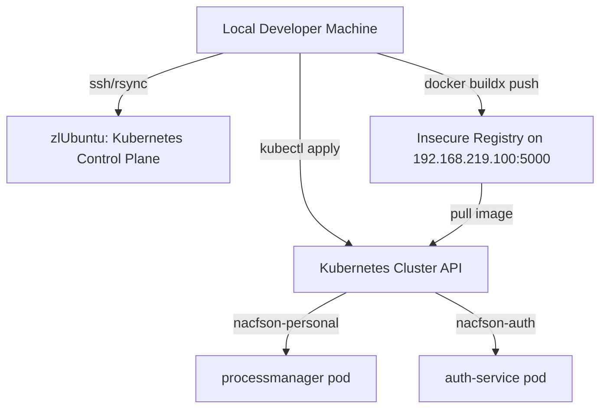

# Deploy Manager Implementation Plan

> **For agentic workers:** REQUIRED SUB-SKILL: Use superpowers:subagent-driven-development to implement this plan task-by-task. Steps use checkbox (`- [ ]`) syntax for tracking.

**Goal:** Build and deploy the Process Manager dashboard and auth stack updates from the local machine to the remote Kubernetes cluster.

**Architecture:** The manager is built into a Linux/amd64 Docker image and pushed to an insecure local container registry (`192.168.219.100:5000`) hosted on the Kubernetes control plane node (`zlUbuntu`). The deployment is rolled out using native Kubernetes manifests and a deploy script that updates resources in the namespaces `nacfson-personal`, `nacfson-auth`, and `nacfson-data`.

**Architecture Diagram:**



**Tech Stack:** Go, Docker Buildx, Kubernetes, kubectl, curl, SSH

## Global Constraints

- Keep the existing Go + HTMX stack; do not add React/Vue/Svelte.
- Deploy processmanager and auth-service to their exact namespaces: `nacfson-personal` and `nacfson-auth` respectively.
- Build the container image specifically targetting `linux/amd64` architecture.
- Ensure all tests pass (`go test ./...`) before initiating the push.
- Check that the local insecure registry `192.168.219.100:5000` is active and reachable.

---

### Task 1: Configure Local Kubeconfig

Configure local `kubectl` to connect to the remote Kubernetes cluster API server using the credentials from `zlUbuntu`.

**Files:**
- Create: `/Users/hyungjuyu/.kube/config`

**Interfaces:**
- Consumes: SSH credentials for `zlUbuntu` configured in `~/.ssh/config`.
- Produces: Working local `kubectl` connection pointing to `https://192.168.219.100:6443`.

- [ ] **Step 1: Verify current local context is empty or unset**

Run: `kubectl config current-context`
Expected output: `error: current-context is not set`

- [ ] **Step 2: Copy the kubeconfig file from remote zlUbuntu server**

Run: `ssh zlUbuntu "cat ~/.kube/config" > ~/.kube/config`
Expected: Command exits with status 0, and the local file is populated.

- [ ] **Step 3: Verify local connection to the cluster**

Run: `kubectl config current-context && kubectl get nodes`
Expected output:
```
kubernetes-admin@kubernetes
NAME                       STATUS                        ROLES           AGE   VERSION
nacfson-zbox-mi527-mi547   Ready                         control-plane   33h   v1.32.13
rllocal                    NotReady,SchedulingDisabled   <none>          33h   v1.32.13
```

- [ ] **Step 4: Verify namespace list**

Run: `kubectl get namespaces`
Expected output: list of namespaces including `nacfson-personal`, `nacfson-auth`, and `nacfson-data`.

- [ ] **Step 5: Log local deployment check status**

Run: `echo "Task 1 completed successfully" > /Users/hyungjuyu/.gemini/antigravity-cli/brain/d7ffb1a4-eee9-4df6-ba0d-c01e621a513b/scratch/task1_status.log`
Expected: Status log file created.


### Task 2: Apply Kubernetes Deployment Manifest

Apply the modified manager deployment manifest containing the optional `SHARED_DATABASE_URL` secret key reference.

**Files:**
- Modify: `k8s/manager/deployment.yaml`

**Interfaces:**
- Consumes: Cluster connectivity established in Task 1.
- Produces: Updated deployment spec in Kubernetes.

- [ ] **Step 1: Perform client-side dry-run validation of the manifest**

Run: `kubectl apply -f k8s/manager/deployment.yaml --dry-run=client`
Expected output: `deployment.apps/processmanager configured (dry run)`

- [ ] **Step 2: Apply the manifest to the cluster**

Run: `kubectl apply -f k8s/manager/deployment.yaml`
Expected output: `deployment.apps/processmanager configured`

- [ ] **Step 3: Confirm manifest config change is active**

Run: `kubectl get deployment processmanager -n nacfson-personal -o jsonpath='{.spec.template.spec.containers[0].env}'`
Expected output contains:
`{"name":"SHARED_DATABASE_URL","valueFrom":{"secretKeyRef":{"key":"DATABASE_URL","name":"shared-app-db-secrets","optional":true}}}`

- [ ] **Step 4: Verify Git working copy status**

Run: `git status`
Expected: No uncommitted implementation code files (only the markdown files under `docs/`).


### Task 3: Build, Push, and Restart Deployment

Compile the local code, build the container image, push it to the registry, and trigger a rollout restart.

**Files:**
- Modify: `scripts/deploy-auth.sh` (run it)

**Interfaces:**
- Consumes: Code from local repository branch `feat/dashboard-ui`.
- Produces: Rebuilt image on the registry and updated active pods in the cluster.

- [ ] **Step 1: Test compile the manager command locally**

Run: `go build -o tmp/manager ./cmd/manager`
Expected: Compilation exits with status 0.

- [ ] **Step 2: Run all local unit tests**

Run: `go test ./...`
Expected: `ok` output for all packages and no test failures.

- [ ] **Step 3: Execute deployment script**

Run: `./scripts/deploy-auth.sh`
Expected output ends with:
```
==> Restarting manager to pick up auth DB connection
deployment.apps/processmanager restarted
deployment.apps/processmanager rolled out
==> Auth foundation deployed. Next: register existing projects and annotate their ingresses.
```

- [ ] **Step 4: Verify processmanager status via Ingress**

Run: `curl -k -I -H "Host: manager.nacfson.cloud" https://192.168.219.100`
Expected output: `HTTP/2 200` or `HTTP/2 302` (redirecting to login page `https://auth.nacfson.cloud/login`).

- [ ] **Step 5: Verify Git workspace is clean**

Run: `git status`
Expected: Status matches local expectation (only uncommitted docs).
