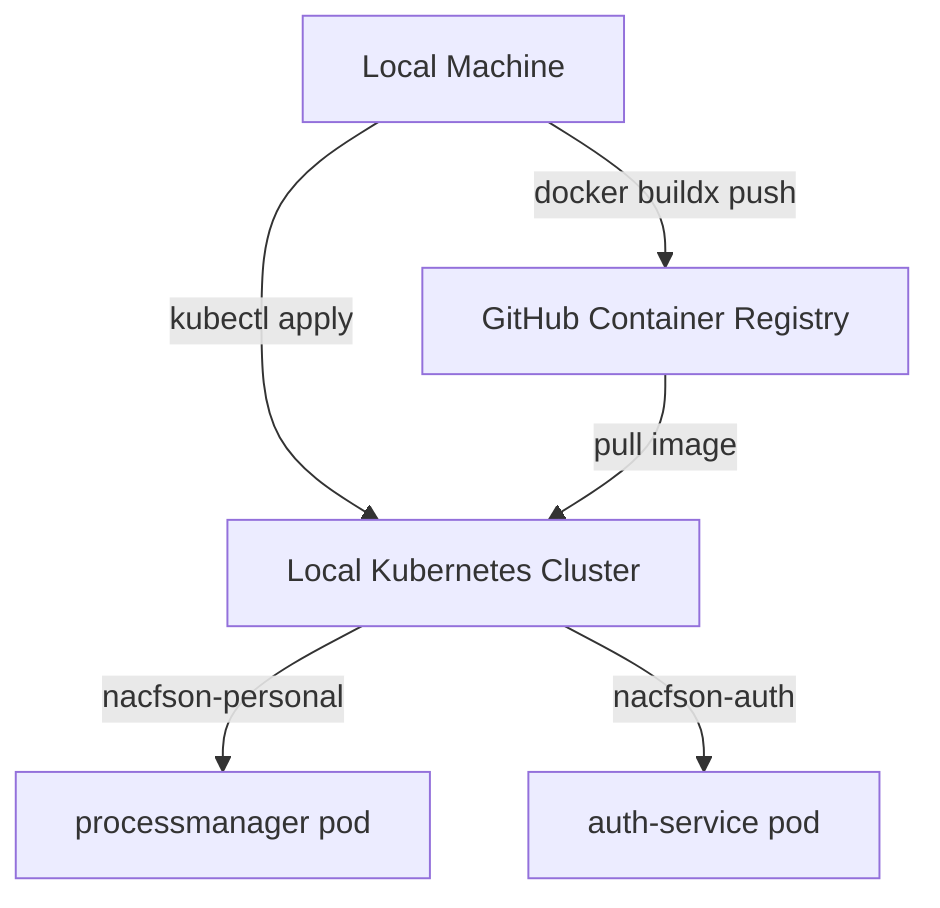

# Deploy Manager Implementation Plan

> **For agentic workers:** REQUIRED SUB-SKILL: Use superpowers:subagent-driven-development to implement this plan task-by-task. Steps use checkbox (`- [ ]`) syntax for tracking.

**Goal:** Build and deploy the Process Manager dashboard and auth stack updates from the local machine to a local Kubernetes cluster.

**Architecture:** The manager and auth service are built as a multi-architecture image and pushed to GitHub Container Registry. The deployment is rolled out from the local machine using native Kubernetes manifests and a deploy script that updates resources in the namespaces `nacfson-personal`, `nacfson-auth`, and `nacfson-data`.

**Architecture Diagram:**



**Tech Stack:** Go, Docker Buildx, Kubernetes, kubectl, curl, GitHub Container Registry

## Global Constraints

- Keep the existing Go + HTMX stack; do not add React/Vue/Svelte.
- Deploy processmanager and auth-service to their exact namespaces: `nacfson-personal` and `nacfson-auth` respectively.
- Build multi-architecture images for `linux/amd64` and `linux/arm64`.
- Ensure all tests pass (`go test ./...`) before initiating the push.
- Authenticate to GHCR with `GHCR_TOKEN` before pushing.

---

### Task 1: Configure Local Kubeconfig

Configure local `kubectl` to use the local Kubernetes cluster context.

**Files:**
- Create: `/Users/hyungjuyu/.kube/config`

**Interfaces:**
- Consumes: The local cluster's kubeconfig context.
- Produces: A working local `kubectl` connection.

- [ ] **Step 1: Verify current local context is empty or unset**

Run: `kubectl config current-context`
Expected output: `error: current-context is not set`

- [ ] **Step 2: Select the local cluster context**

Run: `kubectl config get-contexts`
Expected: The local Kubernetes context is listed.

- [ ] **Step 3: Verify the local connection to the cluster**

Run: `kubectl config current-context && kubectl get nodes`
Expected: The local context is selected and its nodes are reachable.

- [ ] **Step 4: Verify namespace list**

Run: `kubectl get namespaces`
Expected output: list of namespaces including `nacfson-personal`, `nacfson-auth`, and `nacfson-data`.

### Task 2: Apply Kubernetes Deployment Manifest

Apply the modified manager deployment manifest containing the optional `SHARED_DATABASE_URL` secret key reference.

**Files:**
- Modify: `k8s/manager/deployment.yaml`

**Interfaces:**
- Consumes: Cluster connectivity established in Task 1.
- Produces: Updated deployment spec in Kubernetes.

- [ ] **Step 1: Perform client-side dry-run validation of the manifest**

Run: `kubectl apply -f k8s/manager/deployment.yaml --dry-run=client`
Expected output: `deployment.apps/processmanager configured (dry run)`

- [ ] **Step 2: Apply the manifest to the cluster**

Run: `kubectl apply -f k8s/manager/deployment.yaml`
Expected output: `deployment.apps/processmanager configured`

- [ ] **Step 3: Confirm manifest config change is active**

Run: `kubectl get deployment processmanager -n nacfson-personal -o jsonpath='{.spec.template.spec.containers[0].env}'`
Expected output contains:
`{"name":"SHARED_DATABASE_URL","valueFrom":{"secretKeyRef":{"key":"DATABASE_URL","name":"shared-app-db-secrets","optional":true}}}`

- [ ] **Step 4: Verify Git working copy status**

Run: `git status`
Expected: No uncommitted implementation code files (only the markdown files under `docs/`).


### Task 3: Build, Push, and Restart Deployment

Compile the local code, build the container image, push it to the registry, and trigger a rollout restart.

**Files:**
- Modify: `scripts/deploy-auth.sh` (run it)

**Interfaces:**
- Consumes: Code from the current local repository branch.
- Produces: Rebuilt image on the registry and updated active pods in the cluster.

- [ ] **Step 1: Test compile the manager command locally**

Run: `go build -o tmp/manager ./cmd/manager`
Expected: Compilation exits with status 0.

- [ ] **Step 2: Run all local unit tests**

Run: `go test ./...`
Expected: `ok` output for all packages and no test failures.

- [ ] **Step 3: Execute deployment script**

Run: `./scripts/deploy-auth.sh`
Expected output ends with:
```
==> Restarting manager to pick up auth DB connection
deployment.apps/processmanager restarted
deployment.apps/processmanager rolled out
==> Auth foundation deployed. Next: register existing projects and annotate their ingresses.
```

- [ ] **Step 4: Verify processmanager status via Ingress**

Run: `curl -k -I -H "Host: manager.nacfson.cloud" https://<LOCAL_INGRESS_IP>`
Expected output: `HTTP/2 200` or `HTTP/2 302` (redirecting to login page `https://auth.nacfson.cloud/login`).

- [ ] **Step 5: Verify Git workspace is clean**

Run: `git status`
Expected: Status matches local expectation (only uncommitted docs).
