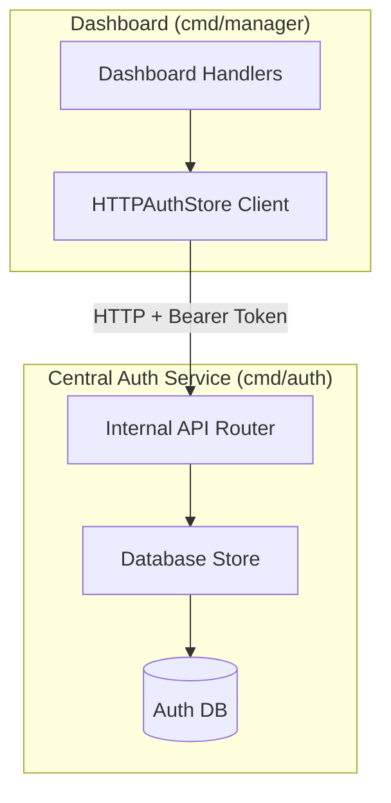

# Centralized Auth Decoupling Implementation Plan

> **For agentic workers:** REQUIRED SUB-SKILL: Use superpowers:subagent-driven-development to implement this plan task-by-task. Steps use checkbox (`- [ ]`) syntax for tracking.

**Goal:** Decouple the Process Manager dashboard from the authentication database entirely, delegating session validation and resource querying (users, projects, audit logs) to the Central Auth Service via a secure internal HTTP API client (`HTTPAuthStore`).

**Architecture:**
* We will abstract the session validation in `internal/auth/middleware.go` using a new interface `SessionValidator` so it can be implemented by both the direct database `Store` (in the auth service) and a new `HTTPAuthStore` (in the dashboard).
* The central auth service (`cmd/auth`) will expose protected `/api/internal/...` JSON routes using a shared secret `AUTH_INTERNAL_TOKEN`.
* The dashboard (`cmd/manager`) will instantiate `HTTPAuthStore` instead of the database-backed `Store`, completely removing its SQL dependency on `auth_db`.

**Architecture Diagram:**



**Tech Stack:** Go (Standard Library net/http), PostgreSQL (pgx/v5)

## Global Constraints
* No direct database connection to `auth_db` allowed in `cmd/manager`.
* All internal service-to-service communication must be authenticated via a `Authorization: Bearer` token.
* Follow TDD for Go handlers and client methods.

---

### Task 1: Abstract Session Validation and Database dependency in Middleware

**Files:**
* Modify: `[internal/auth/middleware.go](file:///Users/hyungjuyu/Projects/Brain/ProcessManager/internal/auth/middleware.go)`

**Interfaces:**
* Consumes: `Session` struct from `internal/auth`
* Produces: `SessionValidator` interface

- [ ] **Step 1: Write the failing test**
  Ensure we can run tests. Add a test in `[internal/auth/middleware_test.go](file:///Users/hyungjuyu/Projects/Brain/ProcessManager/internal/auth/middleware_test.go)` verifying the middleware uses the new interface. Since `internal/auth/handler_test.go` exists, create `middleware_test.go` if it doesn't exist, or modify it. Let's create `internal/auth/middleware_test.go` to test session validation via the validator interface.
  ```go
  package auth

  import (
      "context"
      "net/http"
      "net/http/httptest"
      "testing"
  )

  type mockValidator struct {
      sess *Session
  }

  func (m *mockValidator) GetSessionByTokenHash(ctx context.Context, tokenHash string) (*Session, error) {
      return m.sess, nil
  }

  func TestMiddleware_RequireAuth(t *testing.T) {
      mv := &mockValidator{sess: &Session{UserID: "123", Email: "test@example.com"}}
      mw := NewMiddleware(mv, "auth.local", "local")

      handler := mw.RequireAuth(http.HandlerFunc(func(w http.ResponseWriter, r *http.Request) {
          sess := UserContext(r.Context())
          if sess == nil || sess.UserID != "123" {
              t.Error("expected session in context")
          }
          w.WriteHeader(http.StatusOK)
      }))

      req := httptest.NewRequest("GET", "/", nil)
      req.AddCookie(&http.Cookie{Name: "session", Value: "valid-token"})
      rec := httptest.NewRecorder()

      handler.ServeHTTP(rec, req)
      if rec.Code != http.StatusOK {
          t.Errorf("expected 200, got %d", rec.Code)
      }
  }
  ```

- [ ] **Step 2: Run test to verify it fails**
  Run: `go test -v ./internal/auth -run TestMiddleware_RequireAuth`
  Expected: FAIL (does not compile because `NewMiddleware` expects `*Store`, not mock)

- [ ] **Step 3: Write minimal implementation**
  Modify `[internal/auth/middleware.go](file:///Users/hyungjuyu/Projects/Brain/ProcessManager/internal/auth/middleware.go)`:
  ```diff
  -type Middleware struct {
  -	store        *Store
  -	authHost     string
  -	cookieDomain string
  -}
  -
  -// NewMiddleware creates an auth middleware.
  -func NewMiddleware(store *Store, authHost, cookieDomain string) *Middleware {
  -	return &Middleware{
  -		store:        store,
  -		authHost:     authHost,
  -		cookieDomain: cookieDomain,
  -	}
  -}

  +type SessionValidator interface {
  +	GetSessionByTokenHash(ctx context.Context, tokenHash string) (*Session, error)
  +}
  +
  +type Middleware struct {
  +	validator    SessionValidator
  +	authHost     string
  +	cookieDomain string
  +}
  +
  +// NewMiddleware creates an auth middleware.
  +func NewMiddleware(validator SessionValidator, authHost, cookieDomain string) *Middleware {
  +	return &Middleware{
  +		validator:    validator,
  +		authHost:     authHost,
  +		cookieDomain: cookieDomain,
  +	}
  +}
  ```
  And update references to `m.store` with `m.validator` in `RequireAuth` and `OptionalAuth`.

- [ ] **Step 4: Run test to verify it passes**
  Run: `go test -v ./internal/auth -run TestMiddleware_RequireAuth`
  Expected: PASS

- [ ] **Step 5: Commit**
  Run:
  ```bash
  git add internal/auth/middleware.go
  git commit -m "feat: abstract middleware session validator dependency"
  ```

---

### Task 2: Implement Internal API Endpoints in Central Auth Service

**Files:**
* Modify: `[internal/auth/handler.go](file:///Users/hyungjuyu/Projects/Brain/ProcessManager/internal/auth/handler.go)`

- [ ] **Step 1: Write the failing test**
  Add tests inside `[internal/auth/handler_test.go](file:///Users/hyungjuyu/Projects/Brain/ProcessManager/internal/auth/handler_test.go)` verifying `GET /api/internal/session` returns `401 Unauthorized` without a token, and returns user details when the correct token and session are passed.

- [ ] **Step 2: Run test to verify it fails**
  Run: `go test -v ./internal/auth -run TestHandler_API`
  Expected: FAIL

- [ ] **Step 3: Write minimal implementation**
  Add the token checking middleware and endpoints:
  ```go
  func (h *Handler) verifyInternalToken(next http.HandlerFunc) http.HandlerFunc {
      return func(w http.ResponseWriter, r *http.Request) {
          authHeader := r.Header.Get("Authorization")
          expected := "Bearer " + os.Getenv("AUTH_INTERNAL_TOKEN")
          if authHeader == "" || authHeader != expected {
              w.WriteHeader(http.StatusUnauthorized)
              return
          }
          next(w, r)
      }
  }
  ```
  Register paths in `RegisterRoutes`:
  ```go
  mux.HandleFunc("GET /api/internal/session", h.verifyInternalToken(h.InternalSession))
  mux.HandleFunc("GET /api/internal/projects", h.verifyInternalToken(h.InternalListProjects))
  mux.HandleFunc("POST /api/internal/projects", h.verifyInternalToken(h.InternalCreateProject))
  mux.HandleFunc("GET /api/internal/users", h.verifyInternalToken(h.InternalListUsers))
  mux.HandleFunc("POST /api/internal/audit-events", h.verifyInternalToken(h.InternalLogAudit))
  ```
  Implement the handlers in `internal/auth/handler.go` fetching data from `h.store` and rendering as JSON.

- [ ] **Step 4: Run test to verify it passes**
  Run: `go test -v ./internal/auth -run TestHandler_API`
  Expected: PASS

- [ ] **Step 5: Commit**
  Run:
  ```bash
  git add internal/auth/handler.go internal/auth/handler_test.go
  git commit -m "feat: add internal secure endpoints on auth service"
  ```

---

### Task 3: Create HTTPAuthStore Client in Dashboard

**Files:**
* Create: `[internal/auth/store_client.go](file:///Users/hyungjuyu/Projects/Brain/ProcessManager/internal/auth/store_client.go)`
* Create: `[internal/auth/store_client_test.go](file:///Users/hyungjuyu/Projects/Brain/ProcessManager/internal/auth/store_client_test.go)`

- [ ] **Step 1: Write the failing test**
  Write tests in `store_client_test.go` checking `HTTPAuthStore.ListProjects` makes a GET request to `/api/internal/projects` and correctly parses the returned JSON payload. Use an `httptest.NewServer` to mock the auth service.

- [ ] **Step 2: Run test to verify it fails**
  Run: `go test -v ./internal/auth -run TestHTTPAuthStore`
  Expected: FAIL (file not found/does not compile)

- [ ] **Step 3: Write minimal implementation**
  Create `store_client.go`:
  ```go
  package auth

  import (
      "bytes"
      "context"
      "encoding/json"
      "fmt"
      "net/http"
  )

  type HTTPAuthStore struct {
      client  *http.Client
      baseURL string
      token   string
  }

  func NewHTTPAuthStore(baseURL, token string) *HTTPAuthStore {
      return &HTTPAuthStore{
          client:  &http.Client{},
          baseURL: baseURL,
          token:   token,
      }
  }

  // Implement SessionValidator and handlers.AuthStore interfaces
  ```
  Implement all methods (`GetSessionByTokenHash`, `CreateProject`, `ListProjects`, `ListUsers`, `ListAuditEvents`, `LogAuditEvent`) by performing HTTP requests containing the bearer authentication headers.

- [ ] **Step 4: Run test to verify it passes**
  Run: `go test -v ./internal/auth -run TestHTTPAuthStore`
  Expected: PASS

- [ ] **Step 5: Commit**
  Run:
  ```bash
  git add internal/auth/store_client.go internal/auth/store_client_test.go
  git commit -m "feat: add HTTPAuthStore client for DB decoupling"
  ```

---

### Task 4: Decouple Dashboard Main entrypoint from Auth DB

**Files:**
* Modify: `[cmd/manager/main.go](file:///Users/hyungjuyu/Projects/Brain/ProcessManager/cmd/manager/main.go)`

- [ ] **Step 1: Write the failing test**
  Confirm the dashboard tests compile and run:
  Run: `go test -v ./cmd/manager`
  Expected: PASS (currently runs, but uses SQL config)

- [ ] **Step 2: Modify Dashboard Config**
  Update `main.go` to remove flag `-auth-dsn` and configuration variable `authDSN`.
  Add configuration flag `-auth-service-url` (defaults to `http://auth-service.nacfson-auth.svc.cluster.local:8080`) and `-auth-internal-token` (defaults to env `AUTH_INTERNAL_TOKEN`).
  Instantiate `HTTPAuthStore`:
  ```diff
  -	pool, err := db.NewPool(ctx, *authDSN)
  -	if err != nil {
  -		log.Fatalf("failed to connect to auth db: %v", err)
  -	}
  -	defer pool.Close()
  -	store := auth.NewStore(pool)
  -	if err := store.Migrate(ctx); err != nil {
  -		log.Fatalf("failed to migrate auth db: %v", err)
  -	}
  -	deps.AuthStore = store
  -	deps.AuthMW = auth.NewMiddleware(store, *authHost, *domain)
  +	token := os.Getenv("AUTH_INTERNAL_TOKEN")
  +	store := auth.NewHTTPAuthStore(*authServiceURL, token)
  +	deps.AuthStore = store
  +	deps.AuthMW = auth.NewMiddleware(store, *authHost, *domain)
  ```

- [ ] **Step 3: Run and verify compilation**
  Run: `go test -v ./cmd/manager`
  Expected: PASS

- [ ] **Step 4: Commit**
  Run:
  ```bash
  git add cmd/manager/main.go
  git commit -m "feat: remove Auth SQL connection and use HTTPAuthStore client"
  ```

---

### Task 5: Implement UI improvements in Dashboard and Auth template toggling

**Files:**
* Modify: `[web/templates/components/layout.html](file:///Users/hyungjuyu/Projects/Brain/ProcessManager/web/templates/components/layout.html)`
* Modify: `[web/templates/login.html](file:///Users/hyungjuyu/Projects/Brain/ProcessManager/web/templates/login.html)`

- [ ] **Step 1: Update Login UI state toggling**
  Replace `[web/templates/login.html](file:///Users/hyungjuyu/Projects/Brain/ProcessManager/web/templates/login.html)` with the visual glassmorphism login layout supporting client-side javascript state switches for "Sign In" and "Register".

- [ ] **Step 2: Add Logout and user details to Dashboard Header**
  Inject user details into layout context. Ensure dashboard handler renders pass the user context (retrieved from `auth.UserContext(r.Context())`) to the layout page details.
  Modify `web/templates/components/layout.html` to add the User email and Logout button form pointing to the central logout page.

- [ ] **Step 3: Verify templates parse successfully**
  Run: `go test -v ./internal/handlers/...`
  Expected: PASS

- [ ] **Step 4: Commit**
  Run:
  ```bash
  git add web/templates/components/layout.html web/templates/login.html
  git commit -m "style: implement centralized glassmorphism login UI and dashboard header user profile"
  ```

---

### Task 5: Update Kubernetes manifest files

**Files:**
* Modify: `[k8s/manager/deployment.yaml](file:///Users/hyungjuyu/Projects/Brain/ProcessManager/k8s/manager/deployment.yaml)`
* Modify: `[k8s/auth/deployment.yaml](file:///Users/hyungjuyu/Projects/Brain/ProcessManager/k8s/auth/deployment.yaml)`

- [ ] **Step 1: Remove DB secrets and configure environment tokens**
  Update `k8s/manager/deployment.yaml` to remove references to `AUTH_DATABASE_URL` secrets. Add `AUTH_SERVICE_URL` pointing to `http://auth-service.nacfson-auth.svc.cluster.local:8080` and `AUTH_INTERNAL_TOKEN` referencing a secure shared secret.
  Update `k8s/auth/deployment.yaml` to configure `AUTH_INTERNAL_TOKEN` environment variable.

- [ ] **Step 2: Commit**
  Run:
  ```bash
  git add k8s/manager/deployment.yaml k8s/auth/deployment.yaml
  git commit -m "deploy: update Kubernetes manifests with new environment configurations"
  ```
