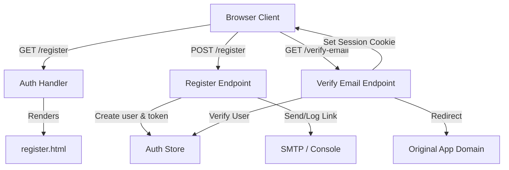

# User Registration and Verification Implementation Plan

> **For agentic workers:** REQUIRED SUB-SKILL: Use superpowers:subagent-driven-development to implement this plan task-by-task. Steps use checkbox (`- [ ]`) syntax for tracking.

**Goal:** Build a user registration UI and endpoint flow with secure email verification, falling back to server log reporting for local/development environments.

**Architecture:** 
1. Database Schema expansion with user verification fields and verification tokens.
2. Form handlers for rendering and submitting registration data.
3. Verification check handler to validate token, activate user, and perform auto-login.
4. UI templates mimicking the existing glassmorphic sign-in panel.

**Architecture Diagram:**


**Tech Stack:** Go, HTML/CSS (Vanilla), PostgreSQL (pgx/v5)

## Global Constraints
- Target Go version: 1.22+
- Encryption standard: bcrypt
- Dependency restrictions: No external CSS frameworks (Vanilla CSS only).

---

### Task 1: Database Schema and Store Updates

**Files:**
- Modify: [store.go](file:///Users/hyungjuyu/Projects/Brain/ProcessManager/internal/auth/store.go)

**Interfaces:**
- Consumes: PostgreSQL DB connection pool.
- Produces: `is_verified` column, `email_verifications` table, and store methods:
  - `CreateEmailVerification(ctx, userID, token, expiresAt)`
  - `GetEmailVerification(ctx, token)`
  - `DeleteEmailVerification(ctx, token)`
  - `VerifyUser(ctx, userID)`

- [ ] **Step 1: Update Schema definition in `store.go`**
  Modify `schema` constant:
  ```diff
   CREATE TABLE IF NOT EXISTS users (
       id UUID PRIMARY KEY DEFAULT gen_random_uuid(),
       email TEXT UNIQUE NOT NULL,
       password_hash TEXT,
       is_admin BOOLEAN NOT NULL DEFAULT false,
  +    is_verified BOOLEAN NOT NULL DEFAULT false,
       created_at TIMESTAMPTZ NOT NULL DEFAULT now()
   );
  +
  +CREATE TABLE IF NOT EXISTS email_verifications (
  +    id UUID PRIMARY KEY DEFAULT gen_random_uuid(),
  +    user_id UUID NOT NULL REFERENCES users(id) ON DELETE CASCADE,
  +    token TEXT UNIQUE NOT NULL,
  +    expires_at TIMESTAMPTZ NOT NULL,
  +    created_at TIMESTAMPTZ NOT NULL DEFAULT now()
  +);
  ```

- [ ] **Step 2: Add migration logic**
  Ensure we alter existing databases that might already have the `users` table created:
  ```diff
   const schema = `
  +ALTER TABLE users ADD COLUMN IF NOT EXISTS is_verified BOOLEAN NOT NULL DEFAULT false;
  +
   CREATE EXTENSION IF NOT EXISTS "pgcrypto";
  ```

- [ ] **Step 3: Add `EmailVerification` struct and methods in `store.go`**
  ```go
  type EmailVerification struct {
      ID        string
      UserID    string
      Token     string
      ExpiresAt time.Time
      CreatedAt time.Time
  }

  func (s *Store) CreateEmailVerification(ctx context.Context, userID, token string, expiresAt time.Time) error {
      _, err := s.pool.Exec(ctx,
          `INSERT INTO email_verifications (user_id, token, expires_at) VALUES ($1, $2, $3)`,
          userID, token, expiresAt)
      return err
  }

  func (s *Store) GetEmailVerification(ctx context.Context, token string) (*EmailVerification, error) {
      var ev EmailVerification
      err := s.pool.QueryRow(ctx,
          `SELECT id, user_id, token, expires_at, created_at FROM email_verifications WHERE token = $1`,
          token).Scan(&ev.ID, &ev.UserID, &ev.Token, &ev.ExpiresAt, &ev.CreatedAt)
      if err != nil {
          if err == pgx.ErrNoRows {
              return nil, nil
          }
          return nil, err
      }
      return &ev, nil
  }

  func (s *Store) DeleteEmailVerification(ctx context.Context, token string) error {
      _, err := s.pool.Exec(ctx, `DELETE FROM email_verifications WHERE token = $1`, token)
      return err
  }

  func (s *Store) VerifyUser(ctx context.Context, userID string) error {
      _, err := s.pool.Exec(ctx, `UPDATE users SET is_verified = true WHERE id = $1`, userID)
      return err
  }
  ```

- [ ] **Step 4: Update `CreateUser` to support `is_verified` input or modify signature**
  We must also make sure admin users bootstrapped are marked verified.
  Modify `CreateUser` and `bootstrapAdmin` accordingly to default `isAdmin` users to `is_verified = true`.

- [ ] **Step 5: Write tests**
  Add unit tests in [store_test.go](file:///Users/hyungjuyu/Projects/Brain/ProcessManager/internal/auth/store_test.go) verifying insertion, retrieval, verification, and token deletion.

- [ ] **Step 6: Run tests and commit**
  Run `go test ./internal/auth/...` and verify everything passes. Commit the changes.

---

### Task 2: UI Templates

**Files:**
- Create: [register.html](file:///Users/hyungjuyu/Projects/Brain/ProcessManager/web/templates/register.html)
- Create: [verification_sent.html](file:///Users/hyungjuyu/Projects/Brain/ProcessManager/web/templates/verification_sent.html)

- [ ] **Step 1: Write `register.html`**
  Implement inputs for `email`, `password`, `confirm_password`, and `return_to`. Design matches `login.html` styling.

- [ ] **Step 2: Write `verification_sent.html`**
  Render text dynamic to whether SMTP is active. If SMTP is inactive, output the verification link dynamically (e.g. `{{.VerificationLink}}`).

- [ ] **Step 3: Commit UI templates**
  Commit the HTML files.

---

### Task 3: Handler Implementations and Routing

**Files:**
- Modify: [handler.go](file:///Users/hyungjuyu/Projects/Brain/ProcessManager/internal/auth/handler.go)

- [ ] **Step 1: Register Routes**
  Add routes:
  ```go
  mux.HandleFunc("GET /register", h.RegisterForm)
  mux.HandleFunc("POST /register", h.Register)
  mux.HandleFunc("GET /verification-sent", h.VerificationSent)
  mux.HandleFunc("GET /verify-email", h.VerifyEmail)
  ```

- [ ] **Step 2: Implement handlers in `handler.go`**
  - Implement `RegisterForm`.
  - Implement `Register`: Validates input, checks existing users, hashes password, saves unverified user, creates token, attempts SMTP delivery or logs output, and redirects to `/verification-sent`.
  - Implement `VerificationSent`.
  - Implement `VerifyEmail`: Validates token, marks verified, sets session token, deletes validation token, redirects to destination.

- [ ] **Step 3: Update `Login` and `APILogin` handlers**
  Ensure logging in checks `user.IsVerified`. If false, rejects and redirects with `error=email not verified`.

- [ ] **Step 4: Add/Run Tests**
  Update [handler_test.go](file:///Users/hyungjuyu/Projects/Brain/ProcessManager/internal/auth/handler_test.go) to verify registration, validation, error scenarios, and verification routes.
  Run `go test ./internal/auth/...` and commit.
