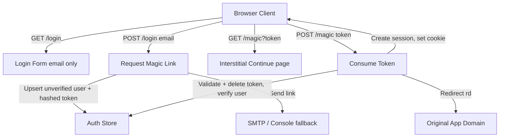

# Passwordless Magic-Link Authentication Implementation Plan

> **For agentic workers:** REQUIRED SUB-SKILL: Use superpowers:subagent-driven-development to implement this plan task-by-task. Steps use checkbox (`- [ ]`) syntax for tracking.

**Goal:** Replace email+password authentication with passwordless "magic link" login: the user enters only their email, receives a one-time sign-in link, and clicking it creates a session. This is the same UX as Claude/Anthropic and Slack login.

**What is a magic link?** A short-lived, single-use URL containing a cryptographically random token, emailed to the user. Possession of the link proves control of the email inbox, so it replaces the password *and* the separate email-verification step at once. Login and registration collapse into one flow: unknown emails get an account created on first successful link click.

**Architecture:**

1. New `login_tokens` table storing SHA-256 hashes of one-time tokens (15 min TTL, single use).
2. `POST /login` takes email only: upserts an unverified user if needed, creates a token, emails the link.
3. `GET /magic?token=...` renders an interstitial "Continue to sign in" page (protects against email scanners that prefetch GET links and would burn the one-time token).
4. `POST /magic` consumes the token, marks the user verified, creates a session, sets the existing `nacfson_session` cookie, redirects to the validated `rd`.
5. Password fields, bcrypt comparison, and the separate `/register` flow are removed. Sessions, `/verify` ingress auth, internal APIs, and the manager are untouched.

**Architecture Diagram:**


**Tech Stack:** Go 1.26 (stdlib `net/http`, `net/smtp`), PostgreSQL (pgx/v5), Vanilla HTML/CSS templates.

## Global Constraints

- Session model unchanged: opaque token, SHA-256 hash in `sessions`, `nacfson_session` cookie, bearer support. No changes to `session.go`, `middleware.go`, `/verify`, or internal APIs.
- Store only token **hashes** in the DB (unlike the current `email_verifications` table which stores raw tokens). Reuse the existing but currently unused `NewAuthCode()` in `internal/auth/authcode.go`.
- Anti-enumeration: `POST /login` always responds "check your email" whether or not the account existed.
- Reuse the existing `loginLimiter` (IP+email) for link requests; also enforce a minimum resend interval per email.
- Keep the dev fallback: when `SMTP_HOST` is empty, print the link to stdout and surface it on the "link sent" page.
- No external dependencies added; bcrypt import is removed from the login path (kept only until Task 7 cleanup).

## Rollout / Compatibility Notes

- **Project PN** logs in via `POST /api/auth/session` with email+password (`AUTH_MODE=central`). Task 5 adds passwordless JSON endpoints; the password-based `APILogin` is kept temporarily and removed in Task 7 after PN migrates.
- **Bootstrap admin & sync-admins** currently require passwords. They become email-only: admins are created verified with a NULL `password_hash` and sign in via magic link like everyone else.
- **SMTP becomes production-critical.** `k8s/auth/deployment.yaml` currently has no SMTP env; Task 6 wires SMTP secrets. Without a working SMTP relay nobody can log in (existing sessions keep working for their 7-day TTL).
- `users.password_hash` is already nullable, so no destructive migration is needed until final cleanup.

---

### Task 1: Store — `login_tokens` table and methods

**Files:**
- Modify: `internal/auth/store.go`
- Modify: `internal/auth/store_test.go`

**Interfaces:**
- Produces: `login_tokens` table and store methods:
  - `CreateLoginToken(ctx, userID, tokenHash string, expiresAt time.Time) error`
  - `ConsumeLoginToken(ctx, tokenHash string) (*LoginToken, error)` — atomically `DELETE ... WHERE token_hash=$1 AND expires_at > now() RETURNING user_id`, so a token can never be redeemed twice.
  - `DeleteLoginTokensByUserID(ctx, userID string) error` — invalidate prior links when a new one is requested.
  - `LatestLoginTokenCreatedAt(ctx, userID string) (time.Time, error)` — for the resend throttle.

- [ ] **Step 1: Add schema**
  ```sql
  CREATE TABLE IF NOT EXISTS login_tokens (
      token_hash TEXT PRIMARY KEY,
      user_id UUID NOT NULL REFERENCES users(id) ON DELETE CASCADE,
      expires_at TIMESTAMPTZ NOT NULL,
      created_at TIMESTAMPTZ NOT NULL DEFAULT now()
  );
  CREATE INDEX IF NOT EXISTS idx_login_tokens_user ON login_tokens(user_id);
  ```

- [ ] **Step 2: Implement the four store methods** following the existing `email_verifications` method style. `ConsumeLoginToken` must be a single atomic statement.

- [ ] **Step 3: Add a periodic cleanup** — reuse the pattern (or add one) for deleting rows where `expires_at < now()`; a simple `DeleteExpiredLoginTokens(ctx)` called from a ticker goroutine in `cmd/auth/main.go` is enough.

- [ ] **Step 4: Tests** — insert/consume/double-consume/expired-token cases in `store_test.go` (guarded by `AUTH_DATABASE_URL` like existing tests). Run `go test ./internal/auth/...` and commit.

---

### Task 2: Extract a shared mailer

The SMTP send block is currently duplicated twice inside `Register` in `internal/auth/handler.go`.

**Files:**
- Create: `internal/auth/mailer.go`
- Modify: `internal/auth/handler.go`

- [ ] **Step 1: Create `Mailer`** with `Send(to, subject, body string) error` reading `SMTP_HOST/PORT/USER/PASS|PASSWORD/FROM` exactly as the current inline code does, plus a `Configured() bool` helper (`SMTP_HOST != ""`).

- [ ] **Step 2: Replace both inline SMTP blocks** in `handler.go` with the mailer. Keep the async `go func()` send and error logging.

- [ ] **Step 3: Add the magic-link email content** — subject "Sign in to nacfson.cloud", plaintext body with the link and a "this link expires in 15 minutes; if you didn't request it, ignore this email" note.

- [ ] **Step 4: `go build ./...`, run tests, commit.**

---

### Task 3: Handlers — passwordless login flow

**Files:**
- Modify: `internal/auth/handler.go`

**Routes after this task:**
```go
mux.HandleFunc("GET /login", h.LoginForm)        // email-only form
mux.HandleFunc("POST /login", h.RequestMagicLink) // replaces password Login
mux.HandleFunc("GET /link-sent", h.LinkSent)      // replaces /verification-sent
mux.HandleFunc("GET /magic", h.MagicForm)         // interstitial Continue page
mux.HandleFunc("POST /magic", h.MagicConsume)     // consume token, create session
mux.HandleFunc("POST /logout", h.Logout)          // unchanged
// GET/POST /register become redirects to /login (301) for bookmarked URLs
```

- [ ] **Step 1: `RequestMagicLink`**
  - Parse form; normalize email (lowercase/trim); validate with `mail.ParseAddress`; validate `return_to` with `validateReturnTo` as today.
  - Rate limit with `loginAllowed` / `recordFailedLogin` as today.
  - Look up user; if missing, `CreateUser(email, "", false, false)` (empty password hash, unverified).
  - Enforce resend throttle (e.g. 60s) via `LatestLoginTokenCreatedAt`; silently succeed if throttled.
  - `NewAuthCode()` → store hash with 15 min TTL after `DeleteLoginTokensByUserID` (one active link per user).
  - Build link `https://{r.Host}/magic?token=...&rd=...`; send via mailer or print to stdout when unconfigured.
  - Always redirect to `/link-sent?rd=...` (plus `token=` only in the no-SMTP dev fallback, mirroring `VerificationSent`).

- [ ] **Step 2: `MagicForm` (GET /magic)** — do **not** consume the token. Render a minimal page with a form that POSTs `token` and `rd` to `/magic` ("Continue to sign in" button). This prevents corporate mail scanners from invalidating one-time links via GET prefetch.

- [ ] **Step 3: `MagicConsume` (POST /magic)**
  - `ConsumeLoginToken(HashSessionToken(token))`; on nil result redirect to `/login?error=link expired or already used`.
  - `VerifyUser(userID)` (first login doubles as email verification), create session via `NewSessionToken` + `CreateSession`, `SetSessionCookie`, redirect to validated `rd` — same tail as today's `VerifyEmail`.

- [ ] **Step 4: Remove password code paths** — delete `Login` (password version), `Register`, `RegisterForm`, `VerificationSent`, `VerifyEmail` handlers and their routes; add permanent redirects from `/register` and `/verify-email` to `/login`. Drop the `bcrypt` import from `handler.go`.

- [ ] **Step 5: Update `handler_test.go`** — replace password login/register tests with: request-link (existing user, new user, bad email, rate limited, throttled resend), GET /magic does not consume, POST /magic happy path (cookie set, user verified, redirect), expired/reused token, redirect validation still enforced. Run tests, commit.

---

### Task 4: UI templates

**Files:**
- Modify: `web/templates/login.html`
- Create: `web/templates/link_sent.html`
- Create: `web/templates/magic.html`
- Delete: `web/templates/register.html`, `web/templates/verification_sent.html`

- [ ] **Step 1: `login.html`** — keep the glassmorphic panel; single email input + "Send sign-in link" button; remove password field and the "Register" link (one flow now). Keep hidden `return_to`.
- [ ] **Step 2: `link_sent.html`** — "Check your email — we sent a sign-in link to your address. It expires in 15 minutes." Render `{{.MagicLink}}` only in the no-SMTP dev fallback (mirroring `verification_sent.html`).
- [ ] **Step 3: `magic.html`** — "Continue to sign in" button posting hidden `token` + `rd` to `/magic`; error state for missing token.
- [ ] **Step 4: Build, eyeball the three pages locally (auth service loads templates from disk), commit.**

---

### Task 5: JSON API for external consumers (Project PN)

**Files:**
- Modify: `internal/auth/handler.go`
- Modify: `internal/auth/handler_test.go`

- [ ] **Step 1: Add passwordless endpoints** (same CORS gate `allowAPIOrigin`, same rate limiter):
  - `POST /api/auth/magic-link` `{ "email": "...", "redirect": "..." }` → 202 always (anti-enumeration). The emailed link points at the central `/magic` page; after consume, the redirect lands back on the consumer app which then holds the shared cookie — or the consumer can poll `GET /api/auth/session`.
  - Keep `GET /api/auth/session`, `GET /api/auth/me`, `DELETE /api/auth/session` unchanged.
- [ ] **Step 2: Keep `POST /api/auth/session` (password login) temporarily**, marked deprecated in code comments, so Project PN keeps working until it migrates. Its removal is Task 7.
- [ ] **Step 3: Tests for the new endpoint (origin allowed/forbidden, 202 for unknown email). Run, commit.**

---

### Task 6: Bootstrap, sync-admins, and Kubernetes wiring

**Files:**
- Modify: `cmd/auth/main.go`
- Modify: `cmd/sync-admins/main.go`
- Modify: `k8s/auth/deployment.yaml`, `k8s/auth/secret.yaml` (or a new `smtp-secret.yaml`)
- Modify: `k8s/auth/bootstrap-secret.yaml`, `k8s/auth/admin-users-secret.yaml`

- [ ] **Step 1: Bootstrap admin without password** — `bootstrapAdmin` creates the `BOOTSTRAP_ADMIN_EMAIL` user with empty `password_hash`, `is_admin=true`, `is_verified=true`. `BOOTSTRAP_ADMIN_PASSWORD` is no longer read; remove it from `bootstrap-secret.yaml`.
- [ ] **Step 2: `sync-admins` email-only** — the YAML becomes a list of admin emails; upsert users as verified admins with no password. Drop bcrypt from `cmd/sync-admins`.
- [ ] **Step 3: SMTP in k8s** — add `SMTP_HOST`, `SMTP_PORT`, `SMTP_USER`, `SMTP_PASS`, `SMTP_FROM` to the auth Deployment env from a Secret (values supplied at deploy time; document in README that magic-link login requires a working SMTP relay).
- [ ] **Step 4: Start the expired-token cleanup ticker in `cmd/auth/main.go`. Build all binaries (`go build ./...`), commit.**

---

### Task 7: Cleanup (after Project PN migrates to the passwordless API)

**Files:**
- Modify: `internal/auth/handler.go`, `internal/auth/store.go`, related tests

- [ ] **Step 1: Remove `POST /api/auth/session` password login** and `apiLoginRequest.Password`.
- [ ] **Step 2: Remove `UpdateUserPassword`, drop the `email_verifications` table usage** (superseded by `login_tokens`) with a guarded `DROP TABLE IF EXISTS email_verifications` migration, and add a migration setting `password_hash` to NULL / dropping the column.
- [ ] **Step 3: Remove `golang.org/x/crypto/bcrypt`** from `go.mod` if no longer referenced anywhere. `go mod tidy`, full test run, commit.

---

## Security checklist (review before merge)

- [ ] Tokens: ≥32 random bytes, stored hashed, 15 min TTL, single-use (atomic consume), one active token per user.
- [ ] GET never consumes the token (scanner-safe interstitial).
- [ ] Uniform "check your email" response — no account enumeration.
- [ ] Rate limits on link requests (IP+email) plus per-email resend throttle.
- [ ] `rd` still funneled through `validateReturnTo` everywhere (login form, email link, consume redirect).
- [ ] Sessions unchanged: HttpOnly/Secure/SameSite=Lax cookie, hashed token in DB.
