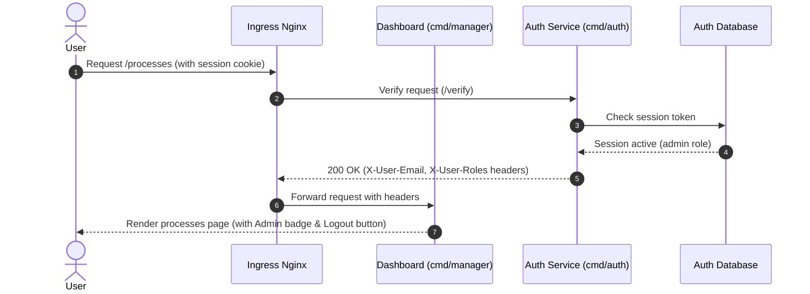

# Centralized Auth Decoupling Design

**Date:** 2026-07-01  
**Status:** Draft / Pending Review  
**Topic:** Improving Process Manager Central Auth System Integration

---

## 1. Background & Objectives

Currently, the **Process Manager Dashboard** (`cmd/manager`) directly connects to the **Auth Database** via the `AUTH_DATABASE_URL` environment variable. It runs PostgreSQL migrations, queries session tables, and directly updates/queries user and project schemas. 

This coupling leads to several issues:
1. **Security Vulnerability:** The dashboard requires credentials to the entire authentication database, violating the principle of least privilege.
2. **Redundant Code & Migrations:** Both the `auth-service` and the `manager` dashboard compile and execute identical database schema migrations.
3. **Deployment Complexity:** Changes in the auth DB structure require updating and redeploying both services simultaneously.

### Objectives:
* **Zero Auth DB access from the Dashboard:** Remove all database clients and DSN configurations for the auth database from the dashboard (`cmd/manager`).
* **Service-to-Service API Wrapper:** Introduce `HTTPAuthStore` inside the dashboard to route project, user, and audit operations to the Central Auth Service over secure internal HTTP calls.
* **Unified central login/register UI:** Provide a premium glassmorphic, interactive central interface for logging in and registering users, ensuring individual distributed projects have zero authentication UI.

---

## 2. Architecture & Data Flow

Below is the decoupled interaction flow:



### Authentication Architecture details:
1. The **Dashboard** is configured with `AUTH_SERVICE_URL` (internal Kubernetes service address) and `AUTH_INTERNAL_TOKEN` (shared secret).
2. The dashboard's `auth.Middleware` is updated to delegate validation. Instead of direct SQL queries, it performs:
   ```http
   GET /api/internal/session
   Cookie: session=<token_value>
   Authorization: Bearer <AUTH_INTERNAL_TOKEN>
   ```
3. In production, we also configure `ingress-nginx` to route `/verify` checks to the Auth Service and forward authentication headers (`X-User-Id`, `X-User-Email`, `X-User-Roles`).

---

## 3. API Contract (Internal API)

The Auth Service (`cmd/auth`) will expose the following new routes under `/api/internal/...`, protected by a token-verification middleware:

### 1. Session Verification
* **Endpoint:** `GET /api/internal/session`
* **Request Headers:**
  * `Authorization: Bearer <AUTH_INTERNAL_TOKEN>`
  * `Cookie: session=<token>`
* **Response (200 OK):**
  ```json
  {
    "user_id": "uuid-string",
    "email": "user@example.com",
    "is_admin": true,
    "expires_at": "2026-07-08T22:00:00Z"
  }
  ```

### 2. Project List
* **Endpoint:** `GET /api/internal/projects`
* **Response (200 OK):**
  ```json
  [
    {
      "id": "uuid",
      "name": "portfolio-web",
      "namespace": "nacfson-personal",
      "domain_host": "portfolio.nacfson.cloud",
      "type": "simple",
      "db_required": false,
      "auth_enabled": true,
      "created_at": "2026-07-01T12:00:00Z"
    }
  ]
  ```

### 3. Project Creation
* **Endpoint:** `POST /api/internal/projects`
* **Request Body:**
  ```json
  {
    "name": "portfolio-web",
    "namespace": "nacfson-personal",
    "domain_host": "portfolio.nacfson.cloud",
    "type": "simple",
    "db_required": false,
    "auth_enabled": true
  }
  ```
* **Response (201 Created):** The created project object.

### 4. User List
* **Endpoint:** `GET /api/internal/users`
* **Response (200 OK):** List of users (emails, admin flags, creation timestamps).

### 5. Audit Logging
* **Endpoint:** `POST /api/internal/audit-events`
* **Request Body:**
  ```json
  {
    "actor_email": "admin@nacfson.cloud",
    "action": "scale",
    "resource_type": "process",
    "resource_id": "portfolio-web"
  }
  ```

---

## 4. UI/UX Changes

### Central UI (Login/Register Card)
A unified glassmorphism login/register card will be hosted on the Auth Service at `https://auth.nacfson.cloud/login`:
* **Design:** Clean typography, glassmorphism panel (`backdrop-filter: blur(20px)`), glowing focus borders, and interactive transitions using Javascript to toggle between "Sign In" and "Sign Up / Register".
* **Mockup:** A visual mockup of the card is illustrated in the project workspace assets.

### Dashboard Header Updates
The main Process Manager Dashboard layout (`web/templates/components/layout.html`) is updated to include:
1. **Logged-in user identity:** `admin@nacfson.cloud`
2. **Admin Badge:** Displays a blue accent badge if `IsAdmin` is true.
3. **Logout Button:** Triggers a POST to `https://auth.nacfson.cloud/logout` to end the session.

---

## 5. Security & Error Handling

### Service-to-Service Security
* **Authentication:** All `/api/internal/...` endpoints require the shared `AUTH_INTERNAL_TOKEN` secret. Requests with incorrect or missing tokens will receive `401 Unauthorized` responses.
* **Network Isolation:** In Kubernetes, the routes under `/api/internal` can be blocked on the external ingress level, ensuring only pods inside the VPC/Cluster can reach the internal endpoint directly.

### Fail-Closed Design
* If the Dashboard's request to the Auth Service times out or fails (5xx/connection issue), the dashboard will immediately **fail-closed** and deny user access.
* The dashboard will display a sanitized error screen: *"Authentication service is temporarily unavailable. Please try again later."* to prevent exposing database internals or service endpoints.

---

## 6. Local Development Configuration

To run and test the complete system locally:

1. **Start the Auth Service on port 8081:**
   ```bash
   PORT=8081 COOKIE_DOMAIN=localhost DATABASE_URL=postgres://... go run ./cmd/auth
   ```
2. **Start the Dashboard on port 8080:**
   ```bash
   PORT=8080 AUTH_SERVICE_URL=http://localhost:8081 AUTH_INTERNAL_TOKEN=dev-secret COOKIE_DOMAIN=localhost go run ./cmd/manager --fake-k8s
   ```
   Both services will communicate over `localhost` and share cookies under the `localhost` domain, preserving the SSO and logout behavior.
